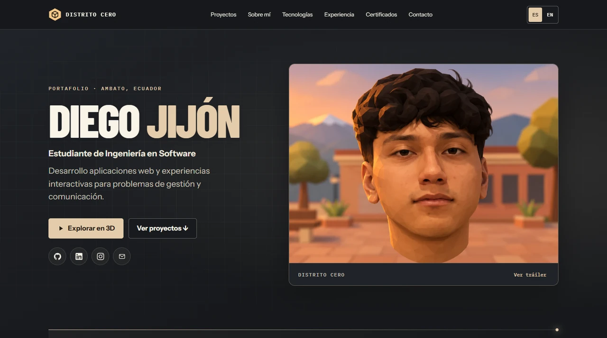
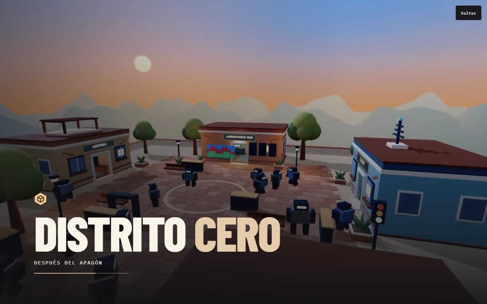
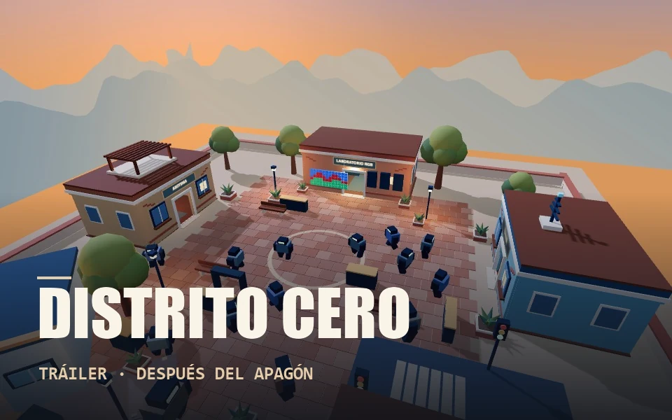
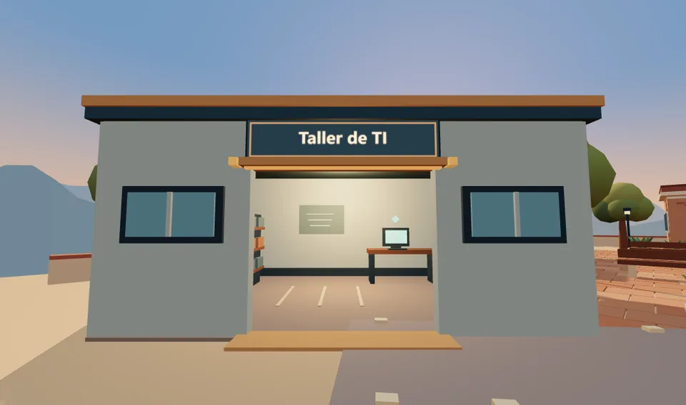
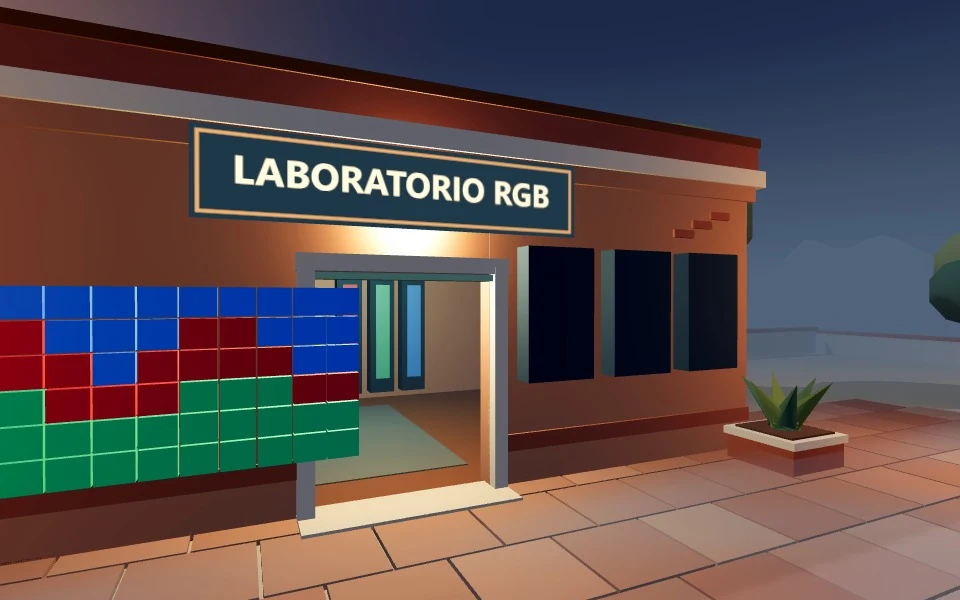

# Distrito Cero

Portafolio bilingüe de Diego Jijón. La campaña 3D **Después del apagón** conecta Ambacar, Laboratorio RGB, TalkApp, Semáforo IA y ASOTEMA. El menú de proyectos y el CV se pueden consultar desde la portada.

## Vista previa

Ver la nueva pantalla de carga

### Tráiler de Después del apagón

El tráiler recorre las cinco estaciones de la campaña y muestra el regreso de la luz al distrito. [Ver el tráiler en MP4](./assets/distrito-trailer.mp4)

### Capturas de la campaña

| Taller de Ambacar | Laboratorio RGB |
| --- | --- |
|  |  |

## Controles

La guía de teclado, ratón y pantalla táctil está en **Ajustes → Controles** dentro del juego.

- **WASD** y ratón para moverte y mirar. Las flechas también funcionan. **Shift** corre y **Ctrl** o **C** agacha.
- **E** usa el dispositivo más cercano. **M** abre el mapa y **T** abre el celular en un punto seguro. **V**, **Ctrl + rueda** y el botón **Cámara** cambian la vista.
- Con el emisor, haz clic para disparar y pulsa **R** para recargar. Las mejoras habilitan **Q** para escanear y **X** para cargar un pulso. El primer clic al recuperar la captura del ratón se usa para capturar el puntero.
- En pantalla táctil, usa el joystick y arrastra el lado opuesto para mirar. Puedes arrastrar **Disparar** para ajustar la mira mientras emites pulsos. En **Ajustes** puedes invertir el lado del joystick, cambiar la sensibilidad y controlar el volumen.

ZEUS desbloquea la salida de Ambacar y concede el emisor. El navegador guarda los hitos y los puntos seguros de la campaña. Puedes continuar desde la portada o volver a empezar desde **Ajustes**. Las demos usan datos ficticios.

La campaña tiene seis niveles. Empieza en Ambacar y revela Laboratorio RGB, TalkApp, Semáforo IA y ASOTEMA al completar sus objetivos en orden. Recoger el repuesto abre el regreso al taller y revela el generador, que se puede poner en marcha tras desactivar al supervisor. Las estaciones descubiertas se pueden volver a visitar y el viaje rápido se habilita al llegar a sus puntos seguros.

Entra en cada estación para usar sus equipos. Ambacar, RGB y ASOTEMA abren un escritorio con su aplicación. TalkApp usa el celular y Semáforo IA se controla desde la tableta de la caseta. Los interiores son puntos seguros. En la calle, los robots resisten más, golpean más fuerte y atacan más rápido conforme avanzas.

Los robots detectan al jugador a distancia y buscan un camino alrededor de las estructuras hasta su última posición conocida. Tras restaurar el distrito, recorren circuitos de mantenimiento por calles, plazas y accesos de las estaciones.

## Código

- `content.js` contiene las fichas de proyectos y las traducciones de la interfaz.
- `experience.js` contiene la trayectoria y las habilidades que comparten el sitio y el CV.
- `main.js` conecta la interfaz del portafolio con el juego y guarda el progreso local.
- `game/campaign.js` guarda los hitos. `game/world.js` coordina las fases de juego, los destinos y las consecuencias en 3D.
- `game/combat.js` simula los robots y el emisor. `game/devices.js` contiene las demos de RGB, TalkApp, Semáforo IA y ASOTEMA.
- `game/scene.js`, `game/camera.js` y `game/avatar.js` contienen la construcción del barrio, las vistas y el personaje animado.
- `game/workshop.js` construye el interior de Ambacar y `game/mission.js` define su terminal bilingüe.

## Vista local

En la raíz, ejecuta `python -m http.server 8000 --bind 127.0.0.1` y abre `http://127.0.0.1:8000`. También puedes usar cualquier servidor estático. Three.js 0.180.0 y su licencia están en `vendor/`.

## GitHub Pages

Publica esta carpeta en la raíz de `diego200509.github.io`. En Settings → Pages, elige **Deploy from a branch**, selecciona la rama `main` y la carpeta **/(root)**.

El menú de proyectos y el CV funcionan sin iniciar el 3D.
